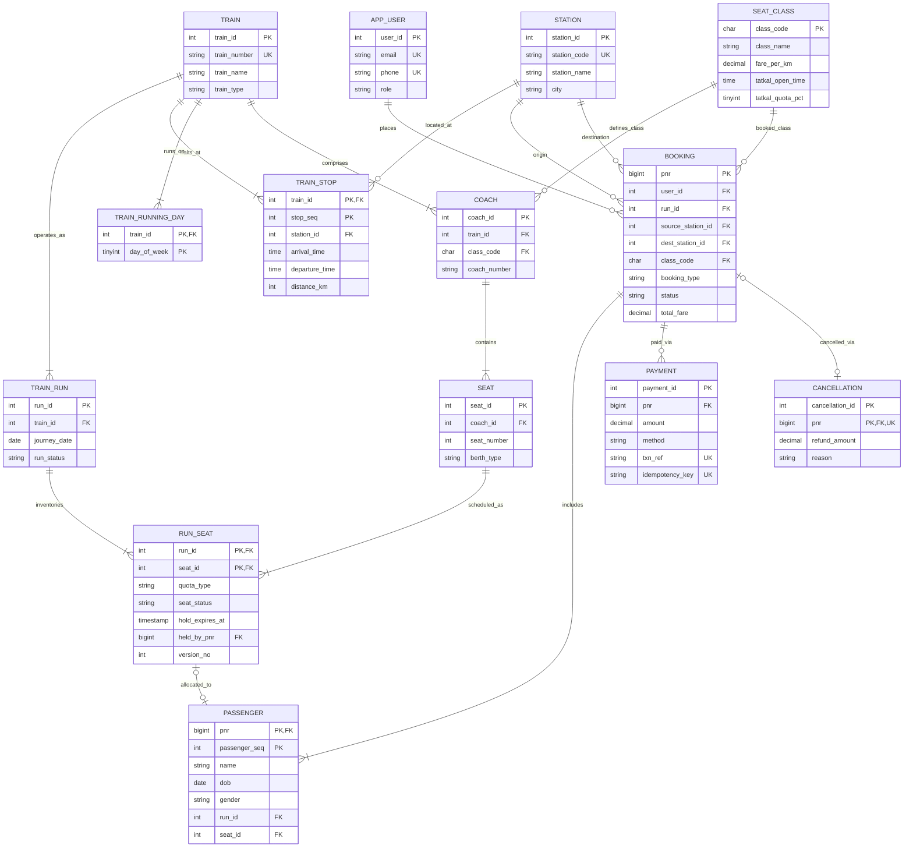

<!-- Owner: Person A -->
# Entity-Relationship (ER) Model & Conceptual Design

## 1. Domain Overview
The Tatkal-Style Train Booking Engine addresses the high-concurrency ticket reservation domain modelled after the Indian Railways Passenger Reservation System (PRS). The system manages train route topology, multi-class rolling stock, scheduled daily train runs, real-time seat inventory, and synchronized transactional reservations.

---

## 2. Entities & Attribute Classification

### 2.1 Strong Entities (Regular Entities)
Strong entities have independent existence in the domain and possess distinct primary keys.

1. **`app_user`**:
   - `user_id` (PK, Integer, Auto Increment)
   - `first_name` (VARCHAR)
   - `last_name` (VARCHAR)
   - `email` (VARCHAR, Unique, Non-null)
   - `phone` (VARCHAR, Unique, 10-digit CHECK regex constraint)
   - `password_hash` (VARCHAR, Argon2/PBKDF2 hashed)
   - `role` (ENUM: `'ADMIN'`, `'CUSTOMER'`)
   - `is_active` (BOOLEAN)
   - `created_at` (TIMESTAMP)

2. **`station`**:
   - `station_id` (PK, Integer, Auto Increment)
   - `station_code` (VARCHAR, Unique e.g., 'SBC', 'MAS', 'NDLS')
   - `station_name` (VARCHAR)
   - `city` (VARCHAR)
   - `state` (VARCHAR)
   - *Composite Full-Text Index on (`station_name`, `city`)*

3. **`train`**:
   - `train_id` (PK, Integer, Auto Increment)
   - `train_number` (VARCHAR, Unique e.g., '12658')
   - `train_name` (VARCHAR)
   - `train_type` (ENUM: `'SUPERFAST'`, `'EXPRESS'`, `'MAIL'`, `'RAJDHANI'`, `'SHATABDI'`)
   - `is_active` (BOOLEAN)
   - *Derived attribute*: `total_coaches` (dynamically aggregated via view/procedure, not redundantly stored to preserve 3NF).

4. **`seat_class`**:
   - `class_code` (PK, CHAR(3) e.g., `'SL'`, `'3A'`, `'2A'`, `'1A'`, `'CC'`)
   - `class_name` (VARCHAR)
   - `is_ac` (BOOLEAN)
   - `fare_per_km` (DECIMAL)
   - `tatkal_open_time` (TIME, 10:00:00 for AC, 11:00:00 for Non-AC)
   - `tatkal_quota_pct` (TINYINT, percentage of coach seats reserved for Tatkal)
   - `tatkal_surcharge_pct` (DECIMAL)
   - `tatkal_min_charge` (DECIMAL)
   - `tatkal_max_charge` (DECIMAL)

5. **`coach`**:
   - `coach_id` (PK, Integer, Auto Increment)
   - `train_id` (FK referencing `train`)
   - `class_code` (FK referencing `seat_class`)
   - `coach_number` (VARCHAR e.g., 'B1', 'B2', 'S1')
   - *Candidate Key / Unique Constraint*: (`train_id`, `coach_number`)

6. **`seat`**:
   - `seat_id` (PK, Integer, Auto Increment)
   - `coach_id` (FK referencing `coach`)
   - `seat_number` (Integer e.g., 1 to 72)
   - `berth_type` (ENUM: `'LB'`, `'MB'`, `'UB'`, `'SL'`, `'SU'`, `'WS'`, `'MS'`, `'AS'`)
   - *Candidate Key / Unique Constraint*: (`coach_id`, `seat_number`)

7. **`train_run`**:
   - `run_id` (PK, Integer, Auto Increment)
   - `train_id` (FK referencing `train`)
   - `journey_date` (DATE)
   - `run_status` (ENUM: `'SCHEDULED'`, `'CANCELLED'`, `'DEPARTED'`)
   - *Candidate Key / Unique Constraint*: (`train_id`, `journey_date`)

8. **`booking`**:
   - `pnr` (PK, BIGINT, starting at 1,000,000,000)
   - `user_id` (FK referencing `app_user`)
   - `run_id` (FK referencing `train_run`)
   - `source_station_id` (FK referencing `station`)
   - `dest_station_id` (FK referencing `station`)
   - `class_code` (FK referencing `seat_class`)
   - `booking_type` (ENUM: `'GENERAL'`, `'TATKAL'`)
   - `status` (ENUM: `'PENDING'`, `'CONFIRMED'`, `'CANCELLED'`, `'EXPIRED'`, `'FAILED'`)
   - `booking_time` (TIMESTAMP)
   - `expires_at` (TIMESTAMP, 8-minute timeout window for pending holds)
   - `total_fare` (DECIMAL)

9. **`payment`**:
   - `payment_id` (PK, Integer, Auto Increment)
   - `pnr` (FK referencing `booking`)
   - `amount` (DECIMAL)
   - `method` (ENUM: `'UPI'`, `'CARD'`, `'NETBANKING'`)
   - `status` (ENUM: `'SUCCESS'`, `'FAILED'`, `'REFUNDED'`)
   - `txn_ref` (VARCHAR, Unique)
   - `idempotency_key` (VARCHAR, Unique, ensures at-most-once payment processing)
   - `created_at` (TIMESTAMP)

10. **`cancellation`**:
    - `cancellation_id` (PK, Integer, Auto Increment)
    - `pnr` (FK referencing `booking`, Unique 1:1)
    - `cancelled_at` (TIMESTAMP)
    - `refund_amount` (DECIMAL)
    - `reason` (TEXT)

11. **`audit_log`**:
    - `log_id` (PK, Integer, Auto Increment)
    - `table_name` (VARCHAR)
    - `record_id` (VARCHAR)
    - `action` (VARCHAR: `'INSERT'`, `'UPDATE'`, `'DELETE'`)
    - `old_value` (JSON)
    - `new_value` (JSON)
    - `changed_at` (TIMESTAMP)

---

### 2.2 Multivalued Attribute Table
- **`train_running_day`**:
  - In conceptual ER modeling, `running_days` is a multivalued attribute of entity `train` (e.g., a train may run on Monday, Wednesday, and Friday).
  - Relational mapping decomposes this multivalued attribute into its own relation:
    - `train_id` (FK referencing `train`)
    - `day_of_week` (TINYINT, 0=Sunday, 1=Monday, ..., 6=Saturday)
    - Composite Primary Key: (`train_id`, `day_of_week`)

---

### 2.3 Weak Entities
Weak entities cannot be uniquely identified by their own attributes alone; their existence and key depend on an identifying relationship with an owner entity.

1. **`train_stop`** (Identifying Owner: `train`):
   - Represents the scheduled halt along a train route.
   - Partial Key (Discriminator): `stop_seq` (the sequence order 1, 2, 3...)
   - Composite Primary Key: (`train_id`, `stop_seq`)
   - Attributes: `station_id` (FK), `arrival_time`, `departure_time`, `day_offset`, `distance_km`
   - *Derived attribute*: `halt_duration` (`departure_time - arrival_time`, calculated in `v_train_route`)
   - Foreign Key constraint: `ON DELETE CASCADE` from `train`.

2. **`run_seat`** (Identifying Owner: `train_run` + `seat`):
   - The core high-concurrency inventory table. Represents the state of a physical seat on a specific calendar run.
   - Composite Primary Key: (`run_id`, `seat_id`)
   - Attributes: `quota_type` (`'GENERAL'`, `'TATKAL'`), `seat_status` (`'AVAILABLE'`, `'HELD'`, `'BOOKED'`), `hold_expires_at`, `held_by_pnr`, `version_no` (optimistic concurrency version token)
   - Foreign Key constraints: `ON DELETE CASCADE` from both `train_run` and `seat`.

3. **`passenger`** (Identifying Owner: `booking`):
   - Represents an individual traveler under a booked ticket.
   - Partial Key (Discriminator): `passenger_seq` (1 through 6)
   - Composite Primary Key: (`pnr`, `passenger_seq`)
   - Attributes: `name`, `dob`, `gender`, `id_proof_type`, `id_proof_no`, `fare_amount`, `status`, `run_id`, `seat_id`
   - *Derived attribute*: `age` (`TIMESTAMPDIFF(YEAR, dob, CURRENT_DATE)`, computed in `v_passenger_age`)
   - Foreign Key constraint: `ON DELETE CASCADE` from `booking`.

---

## 3. Relationships, Cardinality & Participation

| Relationship | Entities Involved | Cardinality | Participation | Description |
| :--- | :--- | :--- | :--- | :--- |
| **User Books** | `app_user` (1) : `booking` (N) | 1:N | Partial (User) - Total (Booking) | A customer can make zero or many bookings; every booking must belong to exactly one user. |
| **Run Has Bookings** | `train_run` (1) : `booking` (N) | 1:N | Partial (Run) - Total (Booking) | A train run can have zero or many bookings; every booking belongs to a run. |
| **Train Has Runs** | `train` (1) : `train_run` (N) | 1:N | Partial (Train) - Total (Run) | A train definition has multiple daily operational runs. |
| **Train Has Stops** | `train` (1) : `train_stop` (N) | 1:N | Total (Train) - Total (Stop) | A train has an ordered route consisting of at least 2 stops (source, destination). |
| **Stop At Station** | `station` (1) : `train_stop` (N) | 1:N | Partial (Station) - Total (Stop) | Stations host stops for multiple train routes. |
| **Train Has Coaches** | `train` (1) : `coach` (N) | 1:N | Total (Train) - Total (Coach) | Every operational train consists of assigned coaches. |
| **Coach Belongs To Class** | `seat_class` (1) : `coach` (N) | 1:N | Partial (Class) - Total (Coach) | Each coach conforms to a single travel class specification. |
| **Coach Has Seats** | `coach` (1) : `seat` (N) | 1:N | Total (Coach) - Total (Seat) | Each coach contains fixed physical seats. |
| **Run Has Seats** | `train_run` (1) : `run_seat` (N) | 1:N | Total (Run) - Total (RunSeat) | A run instantiates inventory records for every physical seat. |
| **Booking Has Passengers** | `booking` (1) : `passenger` (N) | 1:N | Total (Booking) - Total (Passenger) | A booking contains 1 to 6 passengers (1 to 4 for Tatkal). |
| **Passenger Occupies Seat** | `passenger` (1) : `run_seat` (1) | 1:1 | Partial - Partial | A passenger is assigned at most one run seat; a run seat is allocated to at most one passenger per run. |
| **Booking Payment** | `booking` (1) : `payment` (N) | 1:N | Partial (Booking) - Total (Payment) | A booking has one or more payment attempts (retries), concluding in success. |
| **Booking Cancellation** | `booking` (1) : `cancellation` (1) | 1:1 | Partial (Booking) - Total (Cancellation) | At most one cancellation record can exist per PNR. |

---

## 4. Mermaid Conceptual ER Diagram

