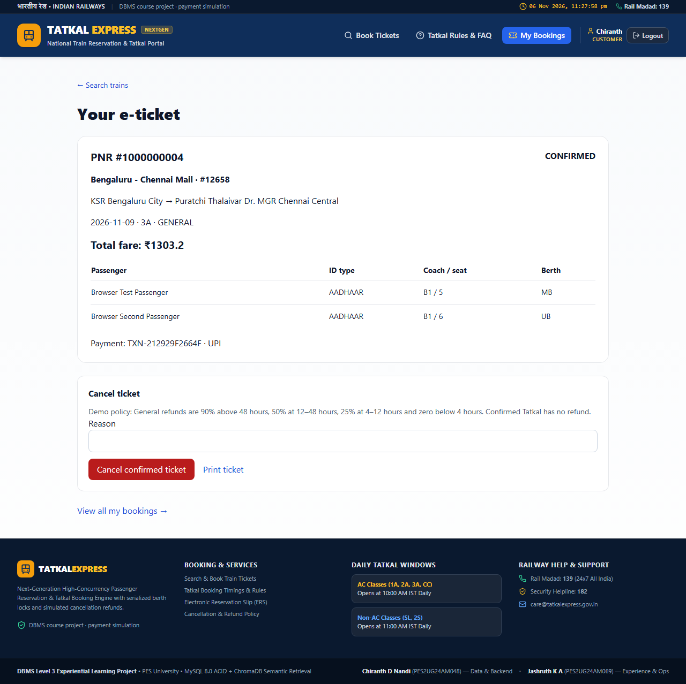
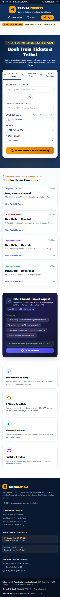
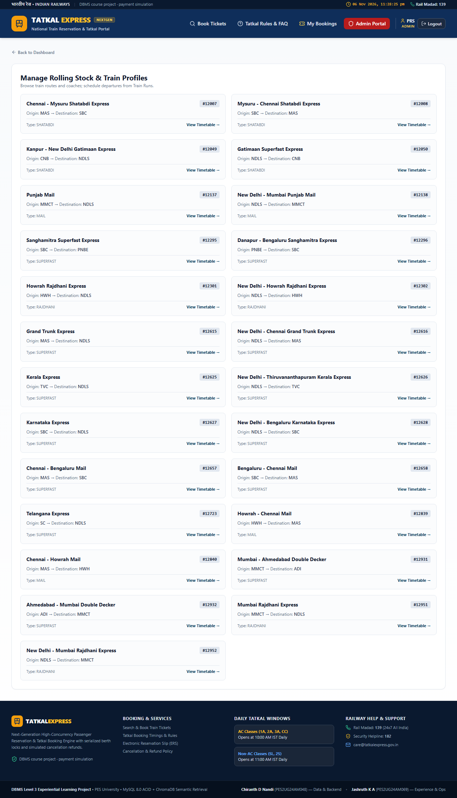

# Verified application screenshots

These are real Chromium captures from the passing end-to-end tests on 6 November 2026, using synthetic demo passengers and transactions.

## Confirmed ticket

## Mobile homepage

## Administrator train catalog

The reproducible browser suite is `frontend/tests/e2e.spec.ts`. It also verifies route search, seat holds, payment, cancellation, semantic search, scheduling and audit inspection.
