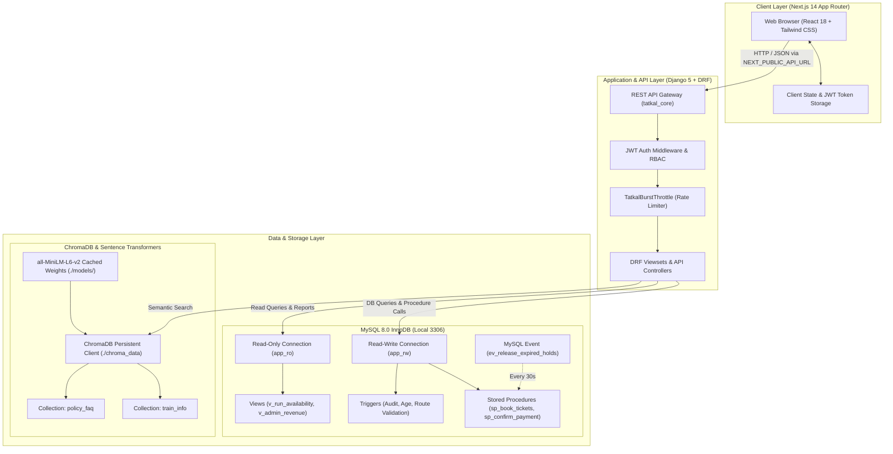
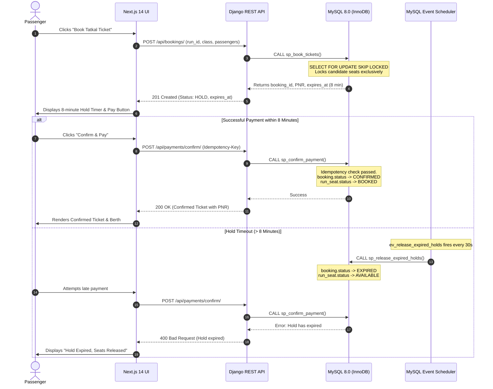

<!-- Owner: Person A -->
# System Architecture Specification

This document details the multi-tier architectural blueprint of the Tatkal High-Concurrency Train Booking System, encompassing presentation, application services, database engines, and offline vector intelligence.

---

## 1. High-Level Architecture Diagram

---

## 2. Multi-Tier Layer Breakdown

### Layer 1: Client Presentation Tier (Person B)
- **Framework**: Next.js 14 App Router with React Server Components (RSC) and client-side hydration.
- **Language**: TypeScript with strict type checking enabled (`strict: true`).
- **Styling**: Tailwind CSS with custom responsive design and Lucide React icons.
- **State & Communication**:
  - Typed API client (`frontend/src/lib/api.ts`) managing automatic JWT access and refresh token rotation.
  - Custom HTTP header injection: `Idempotency-Key` and `Authorization: Bearer <token>`.
  - Tatkal countdown clock synchronizing against server time.
  - Interactive coach seat map with real-time status indicators (Available, Held, Booked).

### Layer 2: API & Application Engine (Person A)
- **Framework**: Python 3.11+ with Django 5.x and Django REST Framework (DRF).
- **Authentication & RBAC**: SimpleJWT customized via `CustomJWTAuthentication` reading from MySQL `app_user` table. Enforces role-based permissions (`IsAdminUserRole` vs `IsCustomerUserRole`).
- **Throttling**: `TatkalBurstThrottle` and `TatkalSustainedThrottle` defending against automated bot spam during rush minutes.
- **Deadlock Resilience**: Automatic exponential backoff retry loop intercepting MySQL Error 1213.

### Layer 3: Relational ACID Storage (Person A)
- **RDBMS**: MySQL 8.0 with InnoDB storage engine, UTF-8 (`utf8mb4`) encoding, and transactions.
- **Separation of Concerns**: Dual database connections:
  - `default`: Read-Write credentials (`app_rw`) executing bookings, payments, and administrative mutations.
  - `readonly`: Read-Only credentials (`app_ro`) serving high-throughput search queries and views.
- **Stored Procedures**: Core transactional logic (`sp_book_tickets`, `sp_confirm_payment`, `sp_cancel_booking`) compiled inside MySQL buffer pool.
- **Row-Level Concurrency**: `SELECT ... FOR UPDATE SKIP LOCKED` eliminates seat reservation race conditions.
- **Background Event**: `ev_release_expired_holds` sweeps abandoned holds every 30 seconds.

### Layer 4: Cognitive Vector Retrieval (Person A & B)
- **Engine**: ChromaDB local persistent client storing embeddings on disk (`./chroma_data`).
- **Offline Model**: `sentence-transformers/all-MiniLM-L6-v2` loaded strictly from local disk (`./models/all-MiniLM-L6-v2`).
- **Index Type**: Hierarchical Navigable Small World (HNSW) graph using cosine distance space.
- **Collections**:
  - `train_info`: Semantic embeddings of train descriptions, destinations, and amenities.
  - `policy_faq`: 14 chunks detailing Tatkal rules, cancellation slabs, and ID mandates.

---

## 3. Concurrency Pipeline: Seat Hold & Payment Flow

